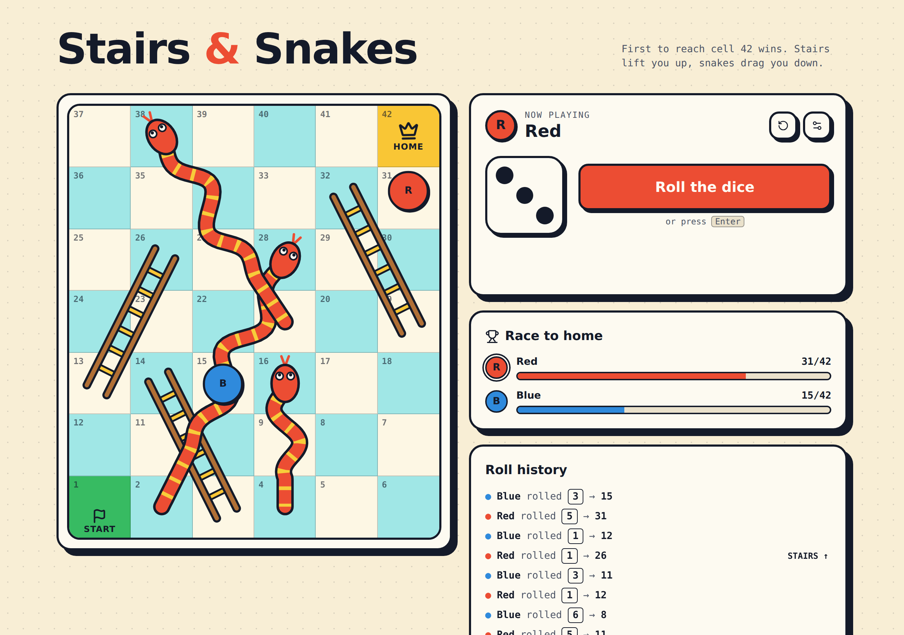
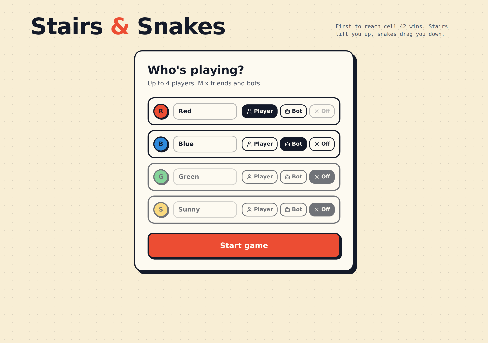

<div align="center">

# 🎲 Stairs & Snakes

**A browser-based stairs-and-snakes board game for up to 4 players, with optional bots.**

Roll the dice, climb the stairs, dodge the snakes, and be the first to reach the final cell.




</div>

## About

Stairs & Snakes is a modern web port of a classic board game originally written in Python (`Stairs_Snake.py`). The game runs entirely in the browser: no backend, no accounts, no setup beyond choosing who plays.

## Features

- **1–4 players:** mix human players and bots in any combination
- **Animated turns:** dice roll, step-by-step token movement, and a highlighted jump on every stairs or snake
- **Live race tracker:** progress bars show every player's position out of 42
- **Roll history:** a log of recent rolls, marked whenever stairs or a snake was hit
- **Keyboard friendly:** press `Enter` or `Space` to roll
- **Responsive layout:** designed for desktop and mobile screens
- **Tested game rules:** all rules are pure functions covered by unit tests

## Screenshots

| Player setup | Game in progress |
| --- | --- |
|  |  |

## How to play

1. Choose who is playing: each of the four slots can be a **Player**, a **Bot**, or **Off**.
2. Take turns rolling the die (1–6) and moving your token along the zig-zag board.
3. Land on the bottom of a **stair** and you climb up. Land on a **snake's head** and you slide down.
4. The first token to reach cell **42** wins. No exact roll is needed to finish.

| | Cells |
| --- | --- |
| 🪜 Stairs | 3 → 14, 13 → 26, 19 → 32 |
| 🐍 Snakes | 38 → 21, 28 → 2, 16 → 4 |

## Getting started

**Prerequisites:** [Node.js](https://nodejs.org/) 22+ and either [Bun](https://bun.sh/) or npm.

```sh
git clone https://github.com/Soroush-dp/stairs-snakes.git
cd stairs-snakes

# with Bun (the repo ships a bun.lock)
bun install
bun run dev

# or with npm
npm install --legacy-peer-deps
npm run dev
```

Then open the local URL printed in the terminal.

### Scripts

| Command | Description |
| --- | --- |
| `dev` | Start the development server |
| `build` | Create a production build |
| `preview` | Preview the production build locally |
| `test` | Run the unit tests once |
| `test:watch` | Run the tests in watch mode |
| `lint` | Lint the project with ESLint |
| `format` | Format the code with Prettier |

## Project structure

```
src/
├── lib/
│   ├── game.ts            # Game rules: board, stairs, snakes, win condition (pure functions)
│   └── game.test.ts       # Unit tests for the rules
├── components/game/
│   ├── SetupScreen.tsx    # Player / bot selection
│   ├── GameScreen.tsx     # Turn flow, animations, bot logic
│   ├── Board.tsx          # Board, stairs, snakes and tokens
│   ├── Dice.tsx           # Dice face
│   └── WinOverlay.tsx     # Winner screen
├── routes/                # File-based routing (TanStack Start)
└── styles.css             # Design tokens and shared utility classes
```

### Design decisions

- **Rules live in one place.** Board size, stairs, snakes and the win condition are defined only in `src/lib/game.ts`. UI components never hard-code cell numbers, which keeps the rules easy to verify against the original Python version.
- **Fully client-side.** Local multiplayer on a single device needs no persistence, so there is no backend.
- **Styling through tokens.** Colors and shared styles are defined in `src/styles.css`, so components contain no raw color values.

## Tech stack

- [TanStack Start](https://tanstack.com/start) and TanStack Router
- [React 19](https://react.dev/) with [TypeScript](https://www.typescriptlang.org/)
- [Tailwind CSS 4](https://tailwindcss.com/) and [Radix UI](https://www.radix-ui.com/) primitives
- [Vite](https://vite.dev/) for tooling
- [Vitest](https://vitest.dev/) and Testing Library for tests

## Acknowledgements

The project was scaffolded with [Lovable](https://lovable.dev).
